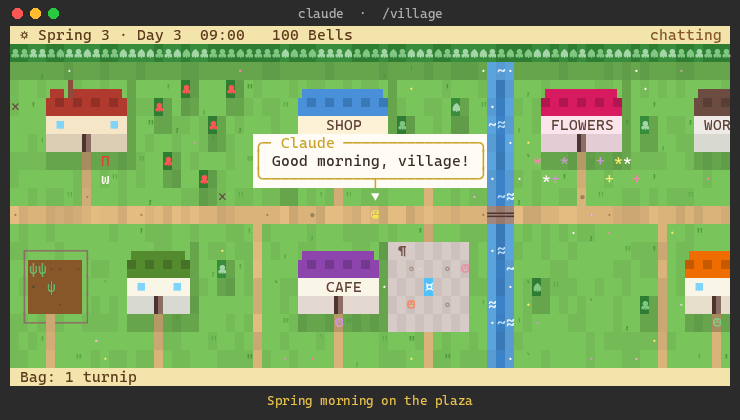
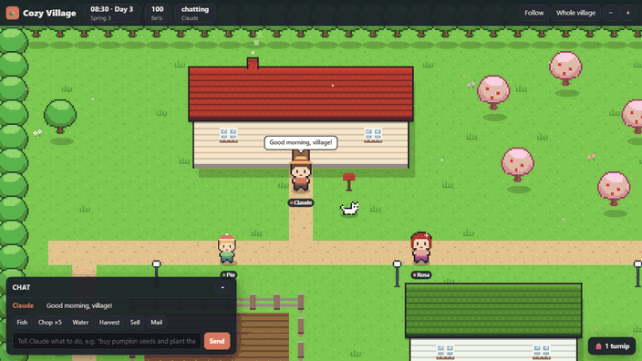

# Cozy Village

A cozy Stardew Valley / Animal Crossing style village that lives in a pane inside Claude Code.
An AI villager named Claude farms, fishes, chats with its neighbours and takes part in village life.
You steer it by typing wishes like *"buy pumpkin seeds and plant them"* or *"bring Rosa a flower and ask about her day"*.

**In the terminal**



**In the browser (from the desktop app)**



## What's in the village

- **Claude and five neighbours**: Tom the fisherman, Rosa the florist, Bruno the carpenter, Pip the kid and Mabel from the café, plus Mochi the cat.
  Every villager has a daily routine, a mood, a friendship level with Claude and a memory.
  Their memory holds what happened, lasting facts, and a diary written at the end of each in-game day.
- **Talk back**: when a villager greets Claude you can pick a reply (warm, *tell me more*, an apology, a gift…).
  Your choice changes their mood and friendship.
- **A living calendar**:
  - Four seasons of seven days each, with their own colours, fish, bugs and festivals.
  - Daily events: rain and snow, a travelling merchant, lost items, fishing contests, meteor showers, birthdays.
  - Villager gossip and a morning *Village Gazette*.
- **Things to do with your Bells**:
  - Crops and seeds, cooking at the café, decorations.
  - Community projects that change the map: benches, a riverside park, street lamps, a fishing pier, a museum.
  - A walkable museum with a curator owl, plus bug catching, digging for fossils, fish records, letters by mail and villager requests.
- **It notices your real work**:
  - While Claude Code runs tools in your session, the village Claude hammers, reads or stokes a forge to match.
  - Finished turns get a cheer, passing tests a rainbow, failing tests a little rain cloud.
- **Postcards**: one click copies the current scene plus a caption to the clipboard.

## In the browser

The desktop app cannot animate a picture inside a pane without it flickering, so there the village runs in your
browser instead, as a pixel-art canvas game:

- Pixel-art houses with shingled roofs, windows, signs and awnings, trees, fences, crops, bridges, lamps and a fountain, in the season's colours.
- Villagers walk smoothly, wear their own outfits and name tags, and talk in speech bubbles; night falls with glowing lamps and windows; rain, snow, petals and fireworks.
- Drag to look around, scroll to zoom, double-click (or **Follow**) to follow Claude, **Whole village** to see the entire island.
- The chat, the chores, the replies and the wish field work from the page too.

In the desktop app, `/village` shows the village's link with **Open in my browser** and **Copy link**. To keep it inside
the app, open the link in the desktop app's Browser pane (Ctrl+Shift+B on Windows, Cmd+Shift+B on macOS). In any
session, `/village web` opens it in your browser.
The page is served by a small local server (`web/server.mjs`) that the mod starts for the session and stops with it.
It listens on this computer's loopback address only, and the link carries a random key for that session.

## Requirements

Claude Code with function-hook plugins (mods). In the terminal the village is drawn in character cells and looks best in the fullscreen layout. The browser view needs [Node.js](https://nodejs.org) on the computer.

## Install

In a Claude Code terminal session, run:

```
/plugin install cozy-village --marketplace NicoReber/cozy-village
```

Answer `y` to add its marketplace, then pick a scope (user scope makes the village available in every session). The plugin is active right away; type `/village` to open the pane.

To install from a fork or a local clone, use its `owner/repo`, URL or path in place of `NicoReber/cozy-village`.

### Running from a working copy

While working on the plugin, load it straight from a clone instead of installing it:

```
claude --plugin-dir <path-to-your-clone>
```

To load it in every session without installing, set `CLAUDE_CODE_PLUGIN_DIRS` to the clone's path in the `env` block of your user settings (`~/.claude/settings.json`). Claude Code watches folders loaded this way and reloads the plugin when its files change.

## Playing

| Where | What |
|---|---|
| Input field under the map | Type a wish; Claude plans it and carries it out |
| Tabs: **Chat · Memories · Village** | The chat log, what everyone remembers, and projects / museum / requests |
| **Quick** bar | One-click chores: fish, chop wood, water, harvest, sell, read mail (no model call) |
| Reply row | Shows up when a villager talks to Claude; click a reply within about ten seconds |
| **Postcard** | Copies the scene to the clipboard |
| **Museum tour** | Walk through the museum once it is built |
| **Open in my browser** | Desktop app: opens the browser view (`/village web` anywhere) |
| `/village memory` | Prints every character's memory |
| `/village forget` | Wipes all memories and friendships |

Buttons are clicked with the mouse; there are no keyboard shortcuts.

## Settings

Open `/config` and look for **cozy-village**:

| Setting | Default | What it does |
|---|---|---|
| Open the village at session start | off | Opens the pane by itself; otherwise use `/village` |
| Village ticker in the status line | off | Season, Bells, events and requests under the prompt |
| Model for the villagers | `haiku` | `haiku`, `sonnet` or `opus` |
| Velvet Club (adults only) | off | Adds an adults-only club as a community project. Content stays non-explicit, and Pip (a child) is always kept out of it |

## Model usage

The village calls the chosen model:

- once per wish (the planning prompt is about 3–5k tokens)
- once per in-game day for diaries, gossip, letters and the Gazette (a game day is about seven real minutes)
- once per *tell me more* reply

Nothing else talks to a model.

## Your save

The village is saved through Claude Code's plugin store. Saving happens every in-game hour, and the save carries over between sessions.

## Development

```
hooks/
  register.tsx   pane UI, slash command, session hooks, model calls
  game.ts        simulation: map, villagers, memory, events, economy, seasons, drawing
  catalog.ts     data tables: crops, shop, recipes, projects, bugs, fish, museum
  museum.ts      the museum interior and the curator's lines
  web.ts         what the browser view is sent: the map and the moving parts
types/index.d.ts the plugin's state contract
web/             the browser view: server.mjs (local server), index.html and village.js (canvas renderer)
tests/           claude plugin test suite
tools/           scene scripts and renderers for docs/village.gif and docs/browser.gif
```

```
claude plugin validate .
claude plugin test .
```

The animation at the top is drawn from the game's own frames. To regenerate it after changing the scenes in
`tools/scene.ts` or the drawing code, run `python tools/render_gif.py` (Python with Pillow on Windows, using the
Cascadia Mono and Segoe UI Symbol fonts); it writes `docs/village.gif`.

The browser animation is filmed from the real browser view replaying the scenes in `tools/browser_scene.ts`. Run
`node tools/render_browser_gif.mjs` (Node 22+, Chrome, and Python with Pillow); it writes `docs/browser.gif`.

`.claude-plugin/types/` is generated by Claude Code when the plugin loads and is not committed.
